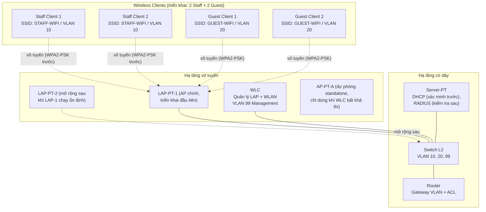

# Topology logic (mức triển khai được)

> Topology dưới đây là **thiết kế dự kiến, chưa kiểm chứng hoạt động**. Sơ đồ thể hiện quan hệ logic đủ rõ để triển khai trong Packet Tracer 9.0.1.0858, nhưng chế độ cổng (trunk/access), ánh xạ WLAN→VLAN và cơ chế join AP→WLC phải được xác định theo đúng model đã chọn (xem [implementation-notes.md](implementation-notes.md)). Không giả định cả ba đoạn dùng chung một thiết kế trunk.

## 1. Thành phần và model đã quan sát

| Thiết bị | Số lượng triển khai | Vai trò | Tình trạng xác minh |
| --- | --- | --- | --- |
| Router | 01 | Định tuyến liên VLAN (subinterface 802.1Q hoặc thiết kế được model hỗ trợ), DHCP relay nếu cần, ACL cô lập Guest | Model cụ thể + ACL chưa kiểm chứng |
| Switch Layer 2 | 01 | VLAN 10, 20, 99; chế độ cổng chốt theo model | VLAN/trunk chưa kiểm chứng |
| WLC | 01 | Quản lý tập trung LAP và WLAN/SSID; GUI `Wireless LANs` đã thấy | Thấy GUI, chưa kiểm chứng tạo WLAN |
| LAP-PT (Lightweight AP) | 01 ở giai đoạn đầu | AP chính, join về WLC qua `Primary Controller`; phát cả hai SSID nếu model cho phép | Thấy trang `WLC`, chưa kiểm chứng join |
| AP mở rộng | +1–2 sau | Chỉ thêm sau khi AP đầu join thành công và client kết nối được | Planned |
| AP-PT-A | Dự phòng | Standalone, chỉ dùng khi chứng minh WLC tập trung bất khả thi + sửa scope | Chưa dùng |
| Server-PT | 01 | DHCP (ưu tiên xác minh trước); kiểm tra thêm khả năng RADIUS | Chưa kiểm chứng |
| Wireless clients | ≥ 4 | 2 Staff + 2 Guest để kiểm thử phân tách và gateway độc lập | Planned |

Các model khác trong palette (3504, 2504, 3702i, AP-PT, AP-PT-AC, AP-PT-N, Meraki, home router, ...) có khả năng khác nhau — không giả định tương đương. Model cuối cùng chốt tại [implementation-notes.md](implementation-notes.md).

## 2. Sơ đồ logic (Mermaid)

> Đường nét đứt là liên kết vô tuyến; đường nét liền là liên kết có dây (dự kiến cáp Copper Straight-Through trong Packet Tracer, loại cáp chốt khi triển khai). AP-PT-A không nối trong sơ đồ chính vì là dự phòng.

## 3. Kết nối logic và quyết định cần chốt theo model

| Kết nối | Ý nghĩa logic | Quyết định chốt khi triển khai (không giả định trước) |
| --- | --- | --- |
| Router ↔ Switch | Liên VLAN, gateway `.1` mỗi VLAN | Subinterface 802.1Q hay thiết kế khác tùy model router; ghi model + interface thực tế |
| Switch ↔ WLC | Quản trị WLC (VLAN 99) + tải WLAN nếu model yêu cầu | Trunk hay access VLAN 99 tùy model WLC; không mặc định trunk |
| Switch ↔ LAP-PT | Uplink AP (quản trị VLAN 99 + tải SSID/VLAN nếu hỗ trợ) | Trunk hay access tùy model LAP-PT; xác minh multi-SSID→multi-VLAN |
| Switch ↔ Server-PT | Server tới đúng VLAN phục vụ DHCP (và RADIUS nếu thử) | Access VLAN chốt sau (99 hoặc theo thiết kế quản trị) |
| LAP-PT ↔ Client | Vô tuyến, SSID ánh xạ tới VLAN | `STAFF-WIFI` → 10, `GUEST-WIFI` → 20; xác thực WPA2-PSK trước |

Chi tiết subnet và gateway chuẩn xem tại [ip-vlan-plan.md](ip-vlan-plan.md) (authoritative). Ba quyết định trunk/access cho WLC mgmt, WLAN mapping và AP uplink được chốt độc lập.

## 4. Thứ tự bring-up (bắt buộc)

1. Dựng có dây: Router–Switch–Server-PT–WLC, kiểm tra WLC management reachability (TC-01).
2. Nối 01 LAP-PT, kiểm tra LAP nhận IP (TC-02) rồi join WLC (TC-03). Dừng lại nếu join thất bại — ghi `Blocked`, chưa thêm AP.
3. Tạo WLAN Staff trước (TC-04), rồi Guest (TC-05); associate + WPA2-PSK từng SSID (TC-06/TC-07).
4. Kiểm tra IP/gateway (TC-08/TC-09), rồi ACL cô lập (TC-10/TC-11), cuối cùng đối chiếu VLAN + hiển thị ACL (TC-12).
5. Chỉ sau khi Core ổn định mới thử RADIUS (TC-13, Conditional).
6. Chỉ thêm LAP thứ 2–3 sau khi AP đầu và client chạy ổn định.

## 5. Lưu ý kiểm chứng

- [ ] Model router/switch/WLC/Server-PT cụ thể và interface thực dùng.
- [ ] Chế độ cổng thực tế cho từng đoạn (ghi lại, không suy từ đoạn khác).
- [ ] LAP-PT join WLC bằng `Primary Controller` như thế nào.
- [ ] AP có hỗ trợ 2 SSID đồng thời và map đúng VLAN không.
- [ ] Server-PT có đồng thời DHCP + RADIUS không.
- [ ] Mọi kết nối chỉ được coi là đúng sau khi có file `.pkt` và minh chứng kiểm thử.
