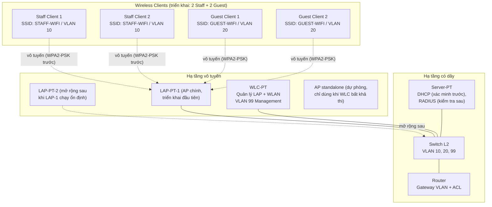

# Topology logic (mức triển khai được)

> Topology dưới đây là **thiết kế đã chốt model, chưa kiểm chứng hoạt động vô tuyến**. Model thiết bị đã chốt, khung có dây và LAP-PT đã dựng trong Packet Tracer 9.0.1.0858 (xem [implementation-notes.md](implementation-notes.md) §1–§2). Ánh xạ WLAN→VLAN và cơ chế join AP→WLC vẫn phải được kiểm chứng trên đúng model đã chốt.
>
> **Cập nhật 2026-10-18 — đổi controller sang `WLC-PT`.** `WLC-3504` không có giao diện cấu hình vô tuyến trong bản 9.0.1.0858 nên không thể làm controller; lý do và minh chứng tại [device-selection-decision.md](device-selection-decision.md). **TC-01 đã chạy lại và `Passed` trên `WLC-PT`** (bản test copy): địa chỉ quản trị `192.168.99.10` đặt trên cổng GUI `Management` (API port `Vlan1`). **Chế độ cổng Switch↔WLC đã chạy được cho management** (`SW1 Fa0/4` trunk native 99); **lưu lượng client VLAN 10/20 vẫn chưa chốt** cho tới khi kiểm chứng central switching (TC-03/TC-08). **`.pkt` deliverable đã thay sang `WLC-PT`** (2026-10-19).

## 1. Thành phần và model đã chốt

| Thiết bị | Model đã chốt | Số lượng triển khai | Vai trò | Tình trạng xác minh |
| --- | --- | --- | --- | --- |
| Router | `2911` | 01 | Định tuyến liên VLAN (subinterface 802.1Q), **DHCP relay bắt buộc** (§3), ACL cô lập Guest | Model đã chốt; subinterface + relay đã dựng; **ACL chưa kiểm chứng** |
| Switch Layer 2 | `2960-24TT` | 01 | VLAN 10, 20, 99; cổng Switch↔WLC, các cổng còn lại chốt theo model | Model đã chốt; VLAN/trunk đã dựng và đọc lại được |
| WLC | **`WLC-PT`** | 01 | Quản lý tập trung LAP và WLAN/SSID; có trang `Wireless LANs` (SSID, VLAN, WPA2-PSK, WPA2 + RADIUS) | Cổng thật: `Vlan1` (mang IP quản trị; GUI hiển thị `Management`) + `GigabitEthernet0` (uplink). **TC-01 chạy lại `Passed`** (`../evidence/tc-01-wlc-pt-reachability-canvas.png`); chưa tạo WLAN. **`WLC-PT` là controller trong `.pkt` deliverable** |
| LAP-PT (Lightweight AP) | `LAP-PT` | 01 ở giai đoạn đầu | AP chính, join về WLC; phát cả hai SSID nếu model cho phép | Đã đấu vào `SW1 Fa0/3` (access VLAN 99) và **có IP `192.168.99.30`** (TC-02 `Passed`); cổng thật là `GigabitEthernet0` + `Dot11Radio0` (catalog ghi `Port 0` là sai); **chưa kiểm chứng join** |
| AP mở rộng | cùng `LAP-PT` | +1–2 sau | Chỉ thêm sau khi AP đầu join thành công và client kết nối được | Planned |
| AP dự phòng | `AccessPoint-PT` standalone | Dự phòng | Standalone, chỉ dùng khi chứng minh WLC tập trung bất khả thi + sửa scope | Chưa dùng; quan sát GUI tại `../evidence/audit-ap-pt-port1-security.png` |
| Server-PT | `Server-PT` | 01 | DHCP (đã tạo pool); kiểm tra thêm khả năng RADIUS | DHCP server chạy; **chưa có client để kiểm chứng cấp phát** |
| Wireless clients | Chưa chốt | ≥ 4 | 2 Staff + 2 Guest để kiểm thử phân tách và gateway độc lập | Planned |

Các model khác trong palette có khả năng khác nhau — không giả định tương đương. Model cuối cùng đã chốt tại [implementation-notes.md](implementation-notes.md) §2.

## 2. Sơ đồ logic (Mermaid)

> Đường nét đứt là liên kết vô tuyến; đường nét liền là liên kết có dây (dự kiến cáp Copper Straight-Through trong Packet Tracer, loại cáp chốt khi triển khai). AP standalone không nối trong sơ đồ chính vì là dự phòng.

## 3. Kết nối logic và quyết định cần chốt theo model

| Kết nối | Ý nghĩa logic | Quyết định chốt khi triển khai |
| --- | --- | --- |
| Router ↔ Switch | Liên VLAN, gateway `.1` mỗi VLAN | **Đã chốt:** router-on-a-stick trên `2911` — `Gi0/0` = `192.168.99.1/24` (VLAN 99 native) + `Gi0/0.10` (dot1Q 10) + `Gi0/0.20` (dot1Q 20) |
| Switch ↔ WLC | Quản trị WLC (VLAN 99) + mang lưu lượng VLAN 10/20 của client | **Management đã chốt trên `WLC-PT`** — `SW1 Fa0/4` trunk native VLAN 99, allowed 10,20,99; `WLC-PT Gi0` uplink (GUI không có tuỳ chọn trunk/VLAN); frame untagged của `Vlan1` rơi vào native 99 ⇒ management ping được (TC-01 `Passed`). **Lưu lượng client VLAN 10/20 chưa chốt** — cần TC-03/TC-08 |
| Switch ↔ LAP-PT | Uplink AP (quản trị VLAN 99 + tải SSID/VLAN nếu hỗ trợ) | **Đã chốt: access VLAN 99 trên `FastEthernet0/3`.** LAP-PT chỉ có `GigabitEthernet0` (Ethernet) + `Dot11Radio0`; không thấy cổng trunk/phụ. IP quản trị đã thông (TC-02 `Passed`); multi-SSID→multi-VLAN còn phải kiểm chứng khi có client |
| Switch ↔ Server-PT | Server tới đúng VLAN phục vụ DHCP (và RADIUS nếu thử) | **Đã chốt:** access VLAN 99 trên `FastEthernet0/2` (theo [ip-vlan-plan.md](ip-vlan-plan.md) §2) |
| LAP-PT ↔ Client | Vô tuyến, SSID ánh xạ tới VLAN | `STAFF-WIFI` → 10, `GUEST-WIFI` → 20; xác thực WPA2-PSK trước. **Chưa kiểm chứng** |

Chi tiết subnet và gateway chuẩn xem tại [ip-vlan-plan.md](ip-vlan-plan.md) (authoritative).

### 3.1 Vì sao Switch↔WLC cần mang cả ba VLAN

- `WLC-PT` có tuỳ chọn **central switching** trong trang `Wireless LANs` (xem [implementation-notes.md](implementation-notes.md) §2 và [device-selection-decision.md](device-selection-decision.md)): lưu lượng client được đẩy về WLC rồi ra cổng có dây.
- `STAFF-WIFI` → VLAN 10 và `GUEST-WIFI` → VLAN 20, nên cổng WLC phải mang đồng thời VLAN 99 (quản trị) + VLAN 10 + VLAN 20.
- Nếu để cổng này là **access VLAN 99**, toàn bộ lưu lượng Staff/Guest bị dồn vào VLAN 99 ⇒ phân đoạng VLAN (REQ-07) bất khả thi và TC-08/TC-12 không thể đạt.

**Đã kiểm chứng trên model cũ `WLC-3504` (TC-01, 2026-10-18):** cổng `WLC1 GigabitEthernet1` mặc định là **access VLAN 1** và khi để nguyên thì trunk SW1 drop toàn bộ (không học được MAC nào trên `Fa0/1`). Chuyển nó sang **trunk** thì thông. Phía WLC phải giữ **native VLAN 1** (không phải 99): SVI `Vlan1` của WLC chỉ hoạt động trong VLAN 1 nội bộ, nên frame untagged của nó rơi vào native VLAN 99 của switch.

**Đã kiểm chứng trên `WLC-PT` (model mới, bản test copy):** cổng `GigabitEthernet0` **không có tuỳ chọn VLAN/trunk trong GUI**, nên **không cần** set trunk phía WLC; chỉ cần đặt trunk ở **phía `SW1 Fa0/4`** (native 99, allowed 10,20,99) là management (VLAN 99) thông (TC-01 `Passed`). Câu `addTrunkVlans` (lỗi trên `WLC-3504`) **không áp dụng được** và không cần. **Còn mở:** mang lưu lượng **client VLAN 10/20** ra uplink — phải trả lời ở TC-03/TC-08.

**Nhánh dự phòng (phải sửa scope nếu xảy ra):** nếu kiểm chứng cho thấy `WLC-PT` không thể mang VLAN 10/20 ra uplink, dừng lại và ghi `Blocked`; chỉ chuyển sang AP standalone kèm sửa phạm vi dự án rõ ràng (xem [project-overview.md](project-overview.md) §2). Không tự ý hạ yêu cầu phân đoạn VLAN.

### 3.2 Vì sao DHCP relay bắt buộc

Server-PT ở VLAN 99 nhưng cấp DHCP cho VLAN 10 và VLAN 20 ⇒ router phải có `ip helper-address 192.168.99.20` trên cả hai subinterface client. Chi tiết tại [ip-vlan-plan.md](ip-vlan-plan.md) §3.1. Thiếu relay ⇒ client không có IP ⇒ TC-08 trở đi đều không kiểm thử được.

## 4. Thứ tự bring-up (bắt buộc)

1. **(xong trên model cũ)** Dựng có dây: Router `2911` – Switch `2960-24TT` – Server-PT – WLC `WLC-3504`; trunk cho cổng Switch↔WLC. Đặt IP quản trị cho WLC và kiểm tra management reachability — **TC-01 `Passed`** ngày 2026-10-18 **trên `WLC-3504`**.
2. **(xong — đã thay trong `.pkt` deliverable)** Thay controller bằng **`WLC-PT`** theo [device-selection-decision.md](device-selection-decision.md); đặt Management IPv4 `192.168.99.10/24` trên cổng GUI **`Management`** (API port `Vlan1`) bằng API (`pt_host_ip_config`); nối `WLC2 Gi0` → `SW1 Fa0/4` (trunk native 99, allowed 10,20,99); **TC-01 chạy lại `Passed`** (`../evidence/tc-01-wlc-pt-reachability-canvas.png`). Cấu hình `WLC-3504` giữ lại như lịch sử P1. **Đã thay `WLC-3504` bằng `WLC-PT` trong `.pkt` deliverable** (2026-10-19).
3. **(xong cấu hình)** Cấu hình DHCP scope trên Server-PT + `ip helper-address` trên router (§3.2). Chưa cần client, nhưng phải xong trước TC-08.
4. **(xong một phần)** Nối 01 LAP-PT, kiểm tra LAP nhận IP — **TC-02 `Passed`** ngày 2026-10-18 (`192.168.99.30` tĩnh trên `GigabitEthernet0`, `SW1 Fa0/3` access VLAN 99).
5. **(cổng chặn)** LAP-PT join `WLC-PT` (TC-03) — chưa tìm thấy trường `Primary Controller` trên LAP-PT và `WLC-PT` không có trang danh sách AP. Nếu join thất bại: ghi `Blocked`, dừng, **không thêm AP**, chưa tạo WLAN.
6. Tạo WLAN Staff trước (TC-04), rồi Guest (TC-05); associate + WPA2-PSK từng SSID (TC-06/TC-07).
7. Kiểm tra IP/gateway (TC-08/TC-09), rồi ACL cô lập (TC-10/TC-11), cuối cùng đối chiếu VLAN + hiển thị ACL (TC-12).
8. Chỉ sau khi Core ổn định mới thử RADIUS (TC-13, Conditional).
9. Chỉ thêm LAP thứ 2–3 sau khi AP đầu và client chạy ổn định.

## 5. Lưu ý kiểm chứng

- [x] Model router/switch/WLC/Server-PT cụ thể và interface thực dùng.
- [x] Controller đã đánh giá và chốt `WLC-PT` (quan sát GUI trực tiếp, có trang `Wireless LANs`).
- [x] **Chạy lại TC-01 trên `WLC-PT`** (bản test copy) — `Passed`, địa chỉ quản trị trên cổng GUI `Management` (API `Vlan1`).
- [x] **Thay `WLC-3504` bằng `WLC-PT` trong `.pkt` deliverable** (Phase C, xong 2026-10-19).
- [ ] Chế độ cổng **Switch↔`WLC-PT`** mang đủ VLAN 99 + 10 + 20 (nếu không → nhánh dự phòng §3.1).
      **VLAN 99 đã kiểm chứng trên cả `WLC-3504` lẫn `WLC-PT`** (TC-01 `Passed`; trên `WLC-PT` chỉ cần trunk phía switch). **VLAN 10/20 cho client vẫn chưa** — cần test với client thật (TC-03/TC-08).
- [x] Đã cấu hình `ip helper-address` cho VLAN 10/20 trỏ về Server-PT (§3.2).
- [x] Chế độ cổng phía switch/router đã chốt: `Gi0/0`→`Gi0/1` (router, trunk), `Fa0/1` (WLC, trunk native 99), `Fa0/2` (server, access VLAN 99), `Fa0/3` (LAP-PT, **access VLAN 99** — TC-02).
- [ ] LAP-PT join `WLC-PT` bằng cơ chế nào (không thấy trường `Primary Controller`; `WLC-PT` không có trang danh sách AP).
- [ ] AP có hỗ trợ 2 SSID đồng thời và map đúng VLAN không.
- [ ] Server-PT có đồng thời DHCP + RADIUS không.
- [ ] Mọi kết nối chỉ được coi là đúng sau khi có file `.pkt` và minh chứng kiểm thử.
