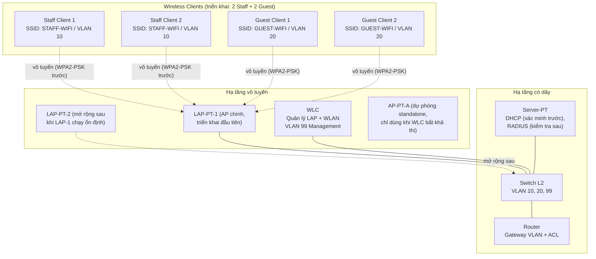

# Topology logic (mức triển khai được)

> Topology dưới đây là **thiết kế đã chốt model, chưa kiểm chứng hoạt động vô tuyến**. Model thiết bị đã chốt và khung có dây đã dựng trong Packet Tracer 9.0.1.0858 (xem [implementation-notes.md](implementation-notes.md) §1–§2). Ánh xạ WLAN→VLAN và cơ chế join AP→WLC vẫn phải được kiểm chứng trên đúng model đã chốt. Riêng cổng Switch↔WLC **bắt buộc trunk** để mang VLAN 99 + 10 + 20 (lý do tại §3) — đã kiểm chứng management reachability (TC-01 `Passed`, 2026-10-18).

## 1. Thành phần và model đã chốt

| Thiết bị | Model đã chốt | Số lượng triển khai | Vai trò | Tình trạng xác minh |
| --- | --- | --- | --- | --- |
| Router | `2911` | 01 | Định tuyến liên VLAN (subinterface 802.1Q), **DHCP relay bắt buộc** (§3), ACL cô lập Guest | Model đã chốt; subinterface + relay đã dựng; **ACL chưa kiểm chứng** |
| Switch Layer 2 | `2960-24TT` | 01 | VLAN 10, 20, 99; cổng Switch↔WLC trunk, các cổng còn lại chốt theo model | Model đã chốt; VLAN/trunk đã dựng và đọc lại được |
| WLC | `WLC-3504` | 01 | Quản lý tập trung LAP và WLAN/SSID; GUI `Wireless LANs` đã thấy | Model đã chốt; **management reachability `Passed`** (TC-01) trên `192.168.99.10`/`Vlan1`; **chưa kiểm chứng tạo WLAN** |
| LAP-PT (Lightweight AP) | `LAP-PT` | 01 ở giai đoạn đầu | AP chính, join về WLC qua `Primary Controller`; phát cả hai SSID nếu model cho phép | Thấy trang `WLC`, **chưa kiểm chứng join** |
| AP mở rộng | cùng `LAP-PT` | +1–2 sau | Chỉ thêm sau khi AP đầu join thành công và client kết nối được | Planned |
| AP-PT-A | `AP-PT-A` | Dự phòng | Standalone, chỉ dùng khi chứng minh WLC tập trung bất khả thi + sửa scope | Chưa dùng |
| Server-PT | `Server-PT` | 01 | DHCP (đã tạo pool); kiểm tra thêm khả năng RADIUS | DHCP server chạy; **chưa có client để kiểm chứng cấp phát** |
| Wireless clients | Chưa chốt | ≥ 4 | 2 Staff + 2 Guest để kiểm thử phân tách và gateway độc lập | Planned |

Các model khác trong palette có khả năng khác nhau — không giả định tương đương. Model cuối cùng đã chốt tại [implementation-notes.md](implementation-notes.md) §2.

## 2. Sơ đồ logic (Mermaid)

> Đường nét đứt là liên kết vô tuyến; đường nét liền là liên kết có dây (dự kiến cáp Copper Straight-Through trong Packet Tracer, loại cáp chốt khi triển khai). AP-PT-A không nối trong sơ đồ chính vì là dự phòng.

## 3. Kết nối logic và quyết định cần chốt theo model

| Kết nối | Ý nghĩa logic | Quyết định chốt khi triển khai |
| --- | --- | --- |
| Router ↔ Switch | Liên VLAN, gateway `.1` mỗi VLAN | **Đã chốt:** router-on-a-stick trên `2911` — `Gi0/0` = `192.168.99.1/24` (VLAN 99 native) + `Gi0/0.10` (dot1Q 10) + `Gi0/0.20` (dot1Q 20) |
| Switch ↔ WLC | Quản trị WLC (VLAN 99) + mang lưu lượng VLAN 10/20 của client | **Trunk bắt buộc** (VLAN 99 untagged/native + VLAN 10, 20 tagged) — lý do tại §3.1. **Đã dựng trên `FastEthernet0/1`** (native 99) và phía WLC `GigabitEthernet1` (trunk, giữ native 1). Management reachability đã `Passed` (TC-01); còn phải chứng minh mang được lưu lượng client |
| Switch ↔ LAP-PT | Uplink AP (quản trị VLAN 99 + tải SSID/VLAN nếu hỗ trợ) | Trunk hay access tùy model LAP-PT; xác minh multi-SSID→multi-VLAN. **Chưa chốt** — phải đọc tên cổng thật trước |
| Switch ↔ Server-PT | Server tới đúng VLAN phục vụ DHCP (và RADIUS nếu thử) | **Đã chốt:** access VLAN 99 trên `FastEthernet0/2` (theo [ip-vlan-plan.md](ip-vlan-plan.md) §2) |
| LAP-PT ↔ Client | Vô tuyến, SSID ánh xạ tới VLAN | `STAFF-WIFI` → 10, `GUEST-WIFI` → 20; xác thực WPA2-PSK trước. **Chưa kiểm chứng** |

Chi tiết subnet và gateway chuẩn xem tại [ip-vlan-plan.md](ip-vlan-plan.md) (authoritative).

### 3.1 Vì sao Switch↔WLC bắt buộc trunk

- WLC đã thấy trường **central switching** trong GUI (xem [implementation-notes.md](implementation-notes.md) §2): lưu lượng client được đẩy về WLC rồi ra cổng có dây.
- `STAFF-WIFI` → VLAN 10 và `GUEST-WIFI` → VLAN 20, nên cổng WLC phải mang đồng thời VLAN 99 (quản trị) + VLAN 10 + VLAN 20.
- Nếu để cổng này là **access VLAN 99**, toàn bộ lưu lượng Staff/Guest bị dồn vào VLAN 99 ⇒ phân đoạn VLAN (REQ-07) bất khả thi và TC-08/TC-12 không thể đạt.

**Đã kiểm chứng một phần (TC-01, 2026-10-18):** cổng `WLC1 GigabitEthernet1` mặc định là **access VLAN 1** và khi để nguyên thì trunk SW1 drop toàn bộ (không học được MAC nào trên `Fa0/1`). Chuyển nó sang **trunk** thì thông. Phía WLC phải giữ **native VLAN 1** (không phải 99): SVI `Vlan1` của WLC chỉ hoạt động trong VLAN 1 nội bộ, nên frame untagged của nó rơi vào native VLAN 99 của switch. **Chưa chứng minh** được trunk phía WLC mang VLAN 10/20 vì chưa khai báo được danh sách VLAN cho phép (`addTrunkVlans` báo sai đối số) và chưa có client.

**Nhánh dự phòng (phải sửa scope nếu xảy ra):** nếu kiểm chứng cho thấy Packet Tracer không hỗ trợ trunk trên cổng WLC, dừng lại và ghi `Blocked`; chỉ chuyển sang AP-PT-A standalone kèm sửa phạm vi dự án rõ ràng (xem [project-overview.md](project-overview.md) §2). Không tự ý hạ yêu cầu phân đoạn VLAN.

### 3.2 Vì sao DHCP relay bắt buộc

Server-PT ở VLAN 99 nhưng cấp DHCP cho VLAN 10 và VLAN 20 ⇒ router phải có `ip helper-address 192.168.99.20` trên cả hai subinterface client. Chi tiết tại [ip-vlan-plan.md](ip-vlan-plan.md) §3.1. Thiếu relay ⇒ client không có IP ⇒ TC-08 trở đi đều không kiểm thử được.

## 4. Thứ tự bring-up (bắt buộc)

1. **(xong)** Dựng có dây: Router `2911` – Switch `2960-24TT` – Server-PT – WLC `WLC-3504`; cấu hình trunk cho cổng Switch↔WLC (§3.1). Đặt IP quản trị cho WLC và kiểm tra management reachability — **TC-01 `Passed`** ngày 2026-10-18.
2. **(xong cấu hình)** Cấu hình DHCP scope trên Server-PT + `ip helper-address` trên router (§3.2). Chưa cần client, nhưng phải xong trước TC-08.
3. Nối 01 LAP-PT, kiểm tra LAP nhận IP (TC-02) rồi join WLC (TC-03). Dừng lại nếu join thất bại — ghi `Blocked`, chưa thêm AP.
4. Tạo WLAN Staff trước (TC-04), rồi Guest (TC-05); associate + WPA2-PSK từng SSID (TC-06/TC-07).
5. Kiểm tra IP/gateway (TC-08/TC-09), rồi ACL cô lập (TC-10/TC-11), cuối cùng đối chiếu VLAN + hiển thị ACL (TC-12).
6. Chỉ sau khi Core ổn định mới thử RADIUS (TC-13, Conditional).
7. Chỉ thêm LAP thứ 2–3 sau khi AP đầu và client chạy ổn định.

## 5. Lưu ý kiểm chứng

- [x] Model router/switch/WLC/Server-PT cụ thể và interface thực dùng.
- [ ] Kiểm chứng **trunk trên cổng Switch↔WLC** mang đủ VLAN 99 + 10 + 20 (nếu không → nhánh dự phòng §3.1).
      **VLAN 99 đã kiểm chứng** (TC-01 `Passed`: ping tới `192.168.99.10` từ `SRV1`, `0% loss`, 2026-10-18). **VLAN 10/20 chưa** — cần client thật và chưa khai báo được danh sách VLAN cho phép trên trunk phía WLC.
- [x] Đã cấu hình `ip helper-address` cho VLAN 10/20 trỏ về Server-PT (§3.2).
- [ ] Chế độ cổng thực tế cho từng đoạn còn lại (ghi lại, không suy từ đoạn khác).
      Đã chốt: `Gi0/0`→`Gi0/1` (router, trunk), `Fa0/1` (WLC, trunk native 99), `Fa0/2` (server, access VLAN 99), `WLC1 GigabitEthernet1` (trunk, native 1 — xem §3.1). **Còn lại: đoạn Switch↔LAP-PT.**
- [ ] LAP-PT join WLC bằng `Primary Controller` như thế nào.
- [ ] AP có hỗ trợ 2 SSID đồng thời và map đúng VLAN không.
- [ ] Server-PT có đồng thời DHCP + RADIUS không.
- [ ] Mọi kết nối chỉ được coi là đúng sau khi có file `.pkt` và minh chứng kiểm thử.
