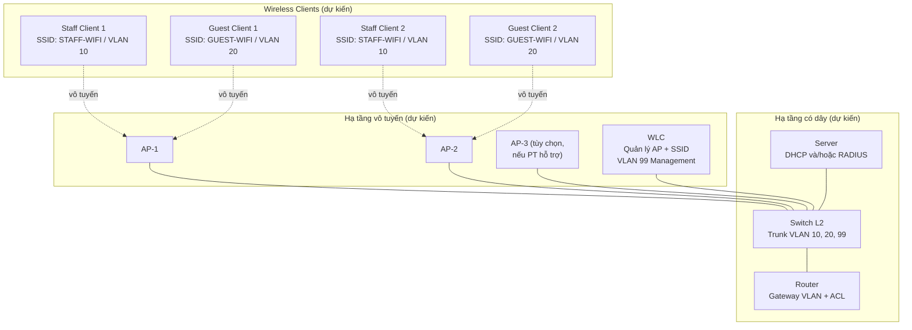

# Topology logic dự kiến

> Topology dưới đây là **đề xuất, chưa kiểm chứng**. Sơ đồ và model thiết bị cuối cùng phụ thuộc vào khả năng hỗ trợ của Cisco Packet Tracer 9.x (xem [implementation-notes.md](implementation-notes.md)).

## 1. Thành phần dự kiến

| Thiết bị | Số lượng dự kiến | Vai trò |
| --- | --- | --- |
| Router | 01 | Định tuyến liên VLAN, DHCP relay (nếu cần), ACL kiểm soát Guest → nội bộ |
| Switch Layer 2 | 01 | Trunk/access VLAN 10, 20, 99 |
| WLC | 01 | Quản lý tập trung AP và SSID |
| Access Point (Lightweight) | 02–03 | Phát sóng `STAFF-WIFI`, `GUEST-WIFI`, đăng ký về WLC |
| Server | 01 | DHCP và/hoặc RADIUS (nếu được hỗ trợ) |
| Wireless clients | ≥ 4 | Ít nhất 2 client staff + 2 client guest để kiểm thử phân tách |

## 2. Sơ đồ logic (Mermaid)

> Đường nét đứt là liên kết vô tuyến; đường nét liền là liên kết có dây (dự kiến dùng cáp Copper Straight-Through trong Packet Tracer).

## 3. Kết nối và VLAN dự kiến

| Kết nối | Chế độ cổng dự kiến | VLAN |
| --- | --- | --- |
| Router ↔ Switch | Trunk (router-on-a-stick) hoặc sub-interface theo VLAN | 10, 20, 99 |
| Switch ↔ WLC | Trunk hoặc access VLAN 99 (tùy model WLC/AP trong Packet Tracer) | 99 (+ trunk nếu cần) |
| Switch ↔ AP | Trunk (để tải nhiều SSID/VLAN) hoặc access theo khả năng thiết bị | 10, 20, 99 |
| Switch ↔ Server | Access VLAN phù hợp (ví dụ VLAN 10 hoặc 99, sẽ chốt sau) | Sẽ chốt sau kiểm chứng |
| AP ↔ Client | Vô tuyến, SSID ánh xạ tới VLAN | `STAFF-WIFI` → 10, `GUEST-WIFI` → 20 |

Chi tiết subnet và gateway xem tại [ip-vlan-plan.md](ip-vlan-plan.md).

## 4. Lưu ý kiểm chứng

- [ ] Xác nhận model WLC/AP có trong Packet Tracer và cơ chế join AP → WLC.
- [ ] Xác nhận AP có hỗ trợ multi-SSID ánh xạ multi-VLAN không.
- [ ] Chốt AP dùng 2 hay 3 thiết bị.
- [ ] Chốt cổng server thuộc VLAN nào và server có hỗ trợ đồng thời DHCP + RADIUS không.
- [ ] Không suy luận rằng sơ đồ trên đã hoạt động — mọi kết nối chỉ được coi là đúng sau khi có file `.pkt` và minh chứng kiểm thử.
