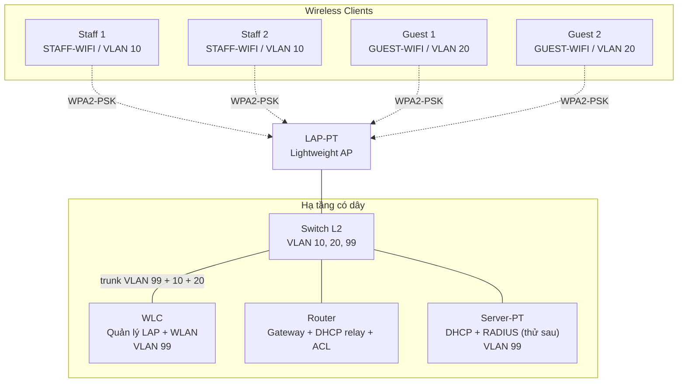

# Báo cáo giữa kỳ

**Đề tài:** Thiết kế, Mô phỏng và Đánh giá Bảo mật Mạng Wi-Fi Doanh nghiệp sử dụng Cisco Packet Tracer

| Hạng mục | Nội dung |
| --- | --- |
| Người tổng hợp | Hoàng Minh Hiếu (nhóm trưởng) |
| Thành viên | Đặng Văn Hoàng, Huỳnh Như Hoàng |
| Ngày báo cáo | Thứ Năm, 22/10/2026 |
| Môi trường mô phỏng | Cisco Packet Tracer 9.0.1.0858 |

> **Tính trung thực của báo cáo:** đây là báo cáo **giữa kỳ**, trình bày **ý tưởng và công việc dự định**. Model thiết bị đã **chốt** sau khi đối chiếu danh mục thực tế và dựng khung có dây P1 (§3.2). Tuy nhiên phần vô tuyến (SSID, WLAN, WPA2) và ACL vẫn là **thiết kế đề xuất, chưa kiểm chứng**, và **mọi test case vẫn ở trạng thái `Not Tested`** — chưa có minh chứng kiểm thử nào. Không có kết quả nào được báo cáo là đã chạy thành công.

---

## 1. Tóm tắt ý tưởng và công việc dự định thực hiện

### 1.1 Ý tưởng

Doanh nghiệp vừa và nhỏ cần một mạng Wi-Fi **quản lý tập trung**, **tách biệt nhân viên và khách**, và **kiểm soát truy cập** giữa các vùng mạng. Thử nghiệm trên thiết bị thật tốn kém và rủi ro.

Đồ án mô phỏng một mạng WLAN doanh nghiệp thu nhỏ trên **Cisco Packet Tracer 9.0.1.0858**, trong đó:

- Nhiều Access Point được quản lý tập trung bởi một **Wireless LAN Controller (WLC)** thay vì cấu hình từng AP.
- Mỗi nhóm người dùng có **SSID và VLAN riêng**, đi kèm subnet và gateway riêng.
- Truy cập vô tuyến được **xác thực bằng WPA2-PSK** trước; RADIUS/WPA2-Enterprise là mục có điều kiện.
- Truy cập giữa các VLAN bị **kiểm soát bằng ACL** trên router.
- Mọi kết luận về bảo mật chỉ được đưa ra **sau khi có minh chứng kiểm thử**, không suy đoán từ giao diện.

### 1.2 Phạm vi dự án

| Nhóm | Nội dung | Vai trò |
| --- | --- | --- |
| **Core** | WLC + LAP-PT + 2 WLAN + WPA2-PSK + VLAN/SSID + IP/gateway + DHCP + ACL cô lập Guest | Bắt buộc, quyết định đạt/không đạt |
| **Conditional** | WPA2-Enterprise + RADIUS cho mạng Staff | Cộng thêm; `Blocked` được chấp nhận kèm lý do |
| **Research-only** | WPA3, EAP-TLS/PEAP, roaming, nhiễu RF, đo throughput | Chỉ làm nền báo cáo, không tính vào tiêu chí hoàn thành |

### 1.3 Công việc dự định thực hiện

| Giai đoạn | Nội dung công việc | Phụ trách | Đầu ra |
| --- | --- | --- | --- |
| P1 | Chốt model thiết bị; dựng topology có dây (Router–Switch–Server-PT–WLC) | Đặng Văn Hoàng dựng; Huỳnh Như Hoàng cấu hình VLAN/trunk; Hiếu review | `.pkt` khung + `show vlan brief` |
| P2 | WLC management reachability; LAP-PT nhận IP và join WLC | Đặng Văn Hoàng | TC-01, TC-02, TC-03 |
| P3 | Tạo và phát 2 WLAN; client associate bằng WPA2-PSK | Đặng Văn Hoàng | TC-04 → TC-07 |
| P4 | Cấu hình DHCP scope trên Server-PT + `ip helper-address` trên router | Huỳnh Như Hoàng | TC-08, TC-09 |
| P5 | ACL cô lập Guest khỏi Staff và thiết bị quản trị | Huỳnh Như Hoàng | TC-10, TC-11, TC-12 |
| P6 | Kiểm thử sai credential bị từ chối | Huỳnh Như Hoàng + Đặng Văn Hoàng | TC-14 (phần PSK) |
| P7 | Khảo sát RADIUS/WPA2-Enterprise (chỉ sau khi Core ổn định) | Đặng Văn Hoàng | TC-13 (Conditional) |
| P8 | Thu thập minh chứng, viết báo cáo cuối, chuẩn bị thuyết trình | Hiếu điều phối, cả nhóm thực hiện | `evidence/`, `report/` |

**Nguyên tắc thứ tự:** đi tuần tự P1 → P8. Chỉ mở rộng lên AP thứ 2–3 **sau khi** AP đầu join thành công và client kết nối được. Không nhảy sang RADIUS khi luồng cơ bản còn lỗi.

### 1.4 Rủi ro đã nhận diện

| Rủi ro | Ứng phó |
| --- | --- |
| LAP-PT không join được WLC | Ghi `Blocked`, chuyển sang AP-PT-A standalone kèm sửa phạm vi rõ ràng |
| Packet Tracer không hỗ trợ trunk trên cổng WLC | Phân đoạn VLAN bất khả thi → ghi `Blocked`, sửa scope, **không hạ yêu cầu** |
| Server-PT không hỗ trợ RADIUS | Ghi `Blocked` cho TC-13, luồng Core vẫn nguyên vẹn |
| WLAN tạo được nhưng không phát / không map đúng VLAN | Kiểm tra lại model và chế độ cổng, không giả định |

---

## 2. Các tính năng chính của sản phẩm

| # | Tính năng | Mô tả | Trạng thái |
| --- | --- | --- | --- |
| 1 | Quản lý tập trung bằng WLC | WLC quản lý LAP-PT và phân phối cấu hình WLAN xuống AP thay vì cấu hình từng AP | Dự định |
| 2 | Nhiều SSID đồng thời | `STAFF-WIFI` và `GUEST-WIFI` phát sóng song song, phục vụ hai nhóm đối tượng | Dự định |
| 3 | Phân đoạn VLAN theo SSID | `STAFF-WIFI` → VLAN 10; `GUEST-WIFI` → VLAN 20; hạ tầng → VLAN 99 | Dự định |
| 4 | Xác thực WPA2-PSK | Cả hai SSID dùng WPA2-PSK; sai key bị từ chối | Dự định |
| 5 | Xác thực WPA2-Enterprise + RADIUS | Mạng Staff xác thực theo từng tài khoản qua RADIUS | Conditional |
| 6 | DHCP tập trung cho mọi VLAN | Server-PT cấp IP cho client Staff/Guest qua DHCP relay | Dự định |
| 7 | Cô lập Guest bằng ACL | Guest không tới được Staff và các thiết bị quản trị, nhưng vẫn nhận được DHCP | Dự định |
| 8 | Bảo vệ mạng quản trị | Thiết bị hạ tầng nằm riêng ở VLAN 99, ưu tiên địa chỉ tĩnh | Dự định |
| 9 | Kiểm thử và minh chứng đầy đủ | 14 test case Core/Conditional, mỗi kết quả gắn với file minh chứng | Dự định |

**Điểm nhấn kỹ thuật:** tính năng số 7 là điểm thú vị nhất — Guest bị chặn khỏi VLAN 99 nhưng **vẫn phải nhận được IP** từ server nằm trong VLAN 99. Điều này buộc ACL phải có ngoại lệ DHCP có chủ đích, chứ không chặn cả subnet.

---

## 3. Mô hình triển khai

### 3.1 Sơ đồ logic

### 3.2 Thiết bị đã chốt

| Vai trò | Số lượng | Model | Trạng thái chốt |
| --- | --- | --- | --- |
| Router | 01 | `2911` | **Đã chốt** |
| Switch Layer 2 | 01 | `2960-24TT` | **Đã chốt** |
| WLC | 01 | `WLC-3504` | **Đã chốt** |
| AP chính | 01 | `LAP-PT` (mở rộng +1–2 sau) | **Đã chốt** |
| AP dự phòng | — | `AP-PT-A` standalone, chỉ dùng khi WLC bất khả thi | Dự phòng |
| Server | 01 | `Server-PT` (DHCP; kiểm tra RADIUS sau) | **Đã chốt** |
| Wireless client | ≥ 4 | 2 Staff + 2 Guest | Chưa chốt chi tiết |

> Model Router/Switch/WLC đã chốt **sau khi** đối chiếu danh mục thiết bị thực tế trong Packet Tracer 9.0.1.0858 và dựng khung có dây — không giả định trước. Chi tiết danh mục, tên cổng thật và hạn chế đã quan sát ghi tại [../docs/implementation-notes.md](../docs/implementation-notes.md).

### 3.3 Kế hoạch VLAN và địa chỉ IP

| VLAN | Name | Subnet | Gateway | Phục vụ |
| --- | --- | --- | --- | --- |
| 10 | STAFF | `192.168.10.0/24` | `192.168.10.1` | Nhân viên (`STAFF-WIFI`) |
| 20 | GUEST | `192.168.20.0/24` | `192.168.20.1` | Khách (`GUEST-WIFI`) |
| 99 | MANAGEMENT | `192.168.99.0/24` | `192.168.99.1` | WLC, switch, router, Server-PT, LAP-PT |

Địa chỉ hạ tầng: switch SVI `192.168.99.2` và Server-PT `192.168.99.20` đã cấu hình trong khung có dây P1; WLC `192.168.99.10` sẽ đặt khi cấu hình WLC.

### 3.4 Hai điểm kỹ thuật quyết định sự thành bại

1. **Cổng Switch↔WLC bắt buộc là trunk.** WLC chạy central switching, phải mang đồng thời VLAN 99 (quản trị) + VLAN 10 + VLAN 20. Nếu để access VLAN 99, toàn bộ lưu lượng Staff/Guest dồn vào một VLAN và yêu cầu phân đoạn coi như thất bại.
2. **DHCP relay là bắt buộc, không phải tùy chọn.** Server-PT nằm ở VLAN 99 nhưng cấp IP cho VLAN 10 và 20, nên router phải có `ip helper-address 192.168.99.20` trên cả hai subinterface client. Thiếu relay ⇒ client không có IP ⇒ toàn bộ các bước kiểm thử sau không chạy được.

---

## 4. Các kịch bản demo (ý tưởng)

### 4.1 Kịch bản chính — "Một ngày tại doanh nghiệp"

**Demo 1 — Nhân viên vào mạng và làm việc**
Kết nối Staff client vào `STAFF-WIFI` bằng WPA2-PSK → nhận IP `192.168.10.x` → `ping` gateway `192.168.10.1` thành công.
*Chứng minh:* WLC + LAP-PT + WLAN + WPA2-PSK + VLAN 10 + DHCP hoạt động.

**Demo 2 — Khách vào mạng**
Kết nối Guest client vào `GUEST-WIFI` → nhận IP `192.168.20.x` → phân biệt rõ với dải IP của Staff.
*Chứng minh:* hai SSID hoạt động đồng thời và ánh xạ đúng VLAN.

**Demo 3 — Khách bị cô lập (điểm nhấn)**
Từ Guest `ping` tới Staff và tới WLC → **thất bại**. Sau đó chạy `show access-lists` trên router để cho thấy luật chặn.
*Chứng minh:* kiểm soát truy cập liên VLAN có hiệu lực thực tế, không chỉ là cấu hình.

**Demo 4 — Ngoại lệ DHCP có chủ đích**
Trong khi Demo 3 cho thấy Guest bị chặn khỏi VLAN 99, Guest **vẫn nhận được IP** từ Server-PT ở VLAN 99. Giải thích: ACL có permit DHCP riêng, chặn cả subnet sẽ làm hỏng chính nó.
*Chứng minh:* hiểu sâu về thiết kế ACL theo dịch vụ, không chặn thô theo subnet.

**Demo 5 — Sai mật khẩu bị từ chối**
Nhập PSK sai → client không associate được, không nhận IP nội bộ.
*Chứng minh:* xác thực WPA2-PSK thực sự hoạt động theo cả hai chiều.

### 4.2 Kịch bản mở rộng (nếu kịp)

| Demo | Nội dung | Điều kiện |
| --- | --- | --- |
| Demo 6 | WPA2-Enterprise: mỗi nhân viên một tài khoản qua RADIUS | Conditional, chỉ khi Core đã ổn định |
| Demo 7 | Mở rộng lên 2–3 AP, cùng SSID phủ rộng hơn | Sau khi AP đầu + client chạy ổn định |
| Demo 8 | So sánh trước/sau ACL: cùng một lệnh `ping`, một lần thông một lần chặn | Luôn làm được, rất trực quan |

### 4.3 Phương án dự phòng khi demo trực tiếp gặp sự cố

Nếu file `.pkt` hoặc Packet Tracer gặp lỗi ngay tại buổi báo cáo:

1. Dùng **ảnh minh chứng đã chụp trước** trong `evidence/` và trình bày theo từng bước.
2. Trình bày sơ đồ topology + bảng VLAN/IP trên slide.
3. Nêu rõ **phần nào đã kiểm chứng, phần nào chưa** — báo cáo lỗi trung thực thay vì che.

### 4.4 Phân công trình bày

| Phần | Người trình bày |
| --- | --- |
| Mở đầu, ý tưởng, phạm vi, kết luận | Hoàng Minh Hiếu |
| Mô hình triển khai, WLC/AP, xác thực vô tuyến | Đặng Văn Hoàng |
| VLAN, DHCP, ACL, kịch bản cô lập Guest | Huỳnh Như Hoàng |

---

## 5. Kết luận giữa kỳ

- Đồ án đã hoàn thành phần **thiết kế và kế hoạch**: topology logic, kế hoạch VLAN/IP, thiết kế bảo mật và bộ 14 test case có truy vết tới yêu cầu.
- **Model thiết bị đã chốt** và **khung có dây P1 đã dựng được**: Router `2911` – Switch `2960-24TT` – Server-PT – WLC `WLC-3504`, gồm VLAN 10/20/99, trunk Switch↔WLC và DHCP relay `ip helper-address` trên router.
- **Chưa có kết quả kiểm thử nào** — mọi test case vẫn `Not Tested`. Phần vô tuyến (WLAN/SSID/WPA2, AP join) và ACL sẽ được bổ sung trong giai đoạn tiếp theo, kèm minh chứng.
- Hai quyết định kỹ thuật quan trọng đã được xác định rõ ngay từ đầu: **trunk bắt buộc** trên cổng WLC và **DHCP relay bắt buộc** trên router.
- Cam kết của nhóm: mọi kết luận về hiệu quả mã hóa và kiểm soát truy cập chỉ được đưa ra khi có minh chứng kiểm thử đi kèm.

---

## Tài liệu tham chiếu

- [../README.md](../README.md) — tổng quan dự án
- [../docs/topology.md](../docs/topology.md) — topology logic và quyết định cổng
- [../docs/ip-vlan-plan.md](../docs/ip-vlan-plan.md) — kế hoạch địa chỉ chuẩn
- [../docs/security-design.md](../docs/security-design.md) — thiết kế bảo mật
- [../docs/testing-plan.md](../docs/testing-plan.md) — kế hoạch kiểm thử
- [../tests/test-cases.md](../tests/test-cases.md) — 14 ca kiểm thử
- [../docs/team-contributions.md](../docs/team-contributions.md) — phân công nhóm
